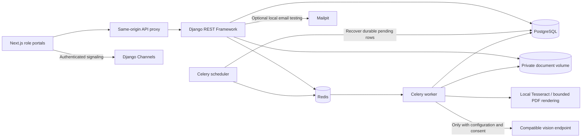
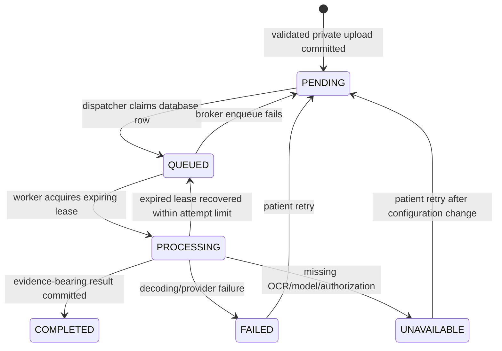

# Architecture

The imported Django apps own their existing domains: accounts, patients, doctors, hospital administration, appointments, laboratories, pharmacies, notifications, and realtime communication. The new `prescription_reader` app owns original uploads, processing state, personal correction history, and clinician reviews. Pure OCR, content validation, extraction, and scheduling calculations can be tested independently from Django.

Authentication uses a short-lived bearer access token held only in browser memory and a rotating HttpOnly refresh cookie. Cookie refresh/logout requires a double-submit CSRF token and an allowed origin. JWT revocation checks password changes. Staff self-registration is forbidden. Two-factor completion requires a short-lived, single-use, signed challenge issued after password verification. Limits use shared Redis in Compose.

Authorization is enforced by backend querysets and permission checks. Patients see their own records; doctors see patients in confirmed/completed workflows; laboratories see assigned orders. Doctor prescription creation checks appointment ownership. Administrative doctor assignment is scoped to the administrator's hospital or an unassigned doctor.

Document retrieval uses a 60-second signed capability containing the authorized user and exact document ID/type. The download handler rechecks the current account and workflow. Public `/media` serving is removed. Files retain original bytes; image normalization/rendering happens only in processing memory.

Appointment creation and rescheduling lock the doctor row inside one transaction, validate generated hospital-local slots, and compare half-open intervals against reserved appointments. A partial unique constraint independently prevents duplicate active start slots. Appointment durations are snapshots, so later schedule edits do not change prior reservation lengths. SQLite is not the concurrent-booking verification target.

The upload row is a durable outbox. Broker failure cannot discard it. A periodic dispatcher recovers pending/expired work; a unique run token prevents a stale worker overwriting a newer attempt. Completion and its in-app notification commit atomically. Automatic recovery is bounded to three processing attempts. Personal corrections and doctor reviews append separate rows, leaving original bytes and machine output unchanged.

The reader never uses a drug dictionary to guess ambiguous text. All recognized fields are unverified, literal values from explicit labels; missing fields remain absent. Vision output is constrained to transcription and remains unverified. The source image is untrusted data, not an instruction channel. Prompting cannot guarantee a model's clinical correctness; external model behavior needs separate validation.
